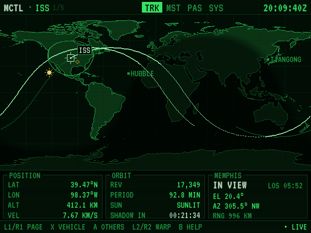
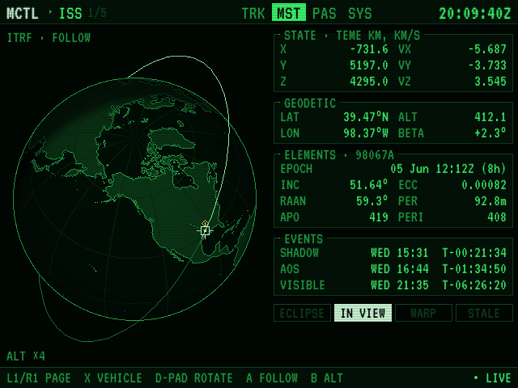
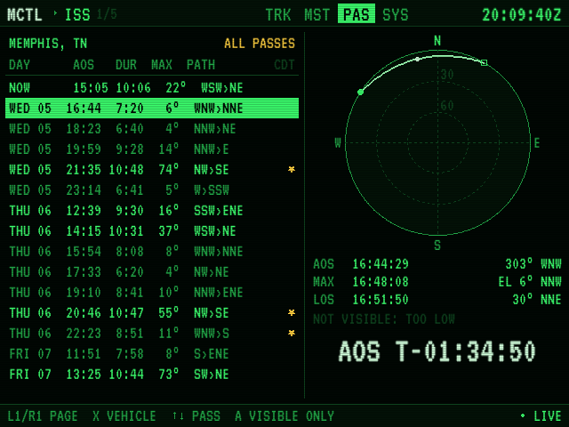
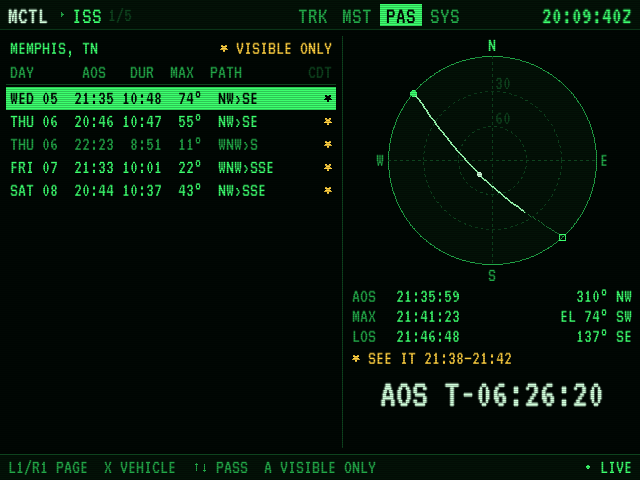
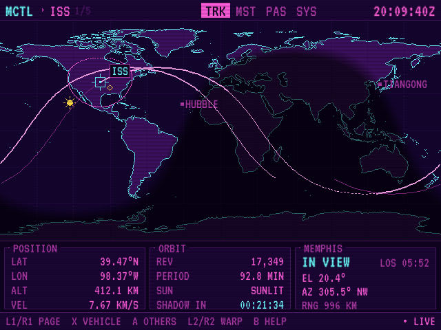
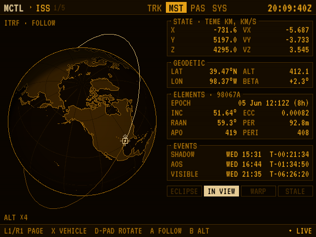
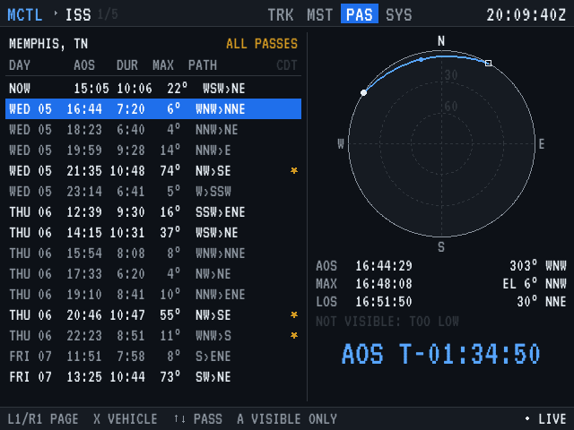

# Miyoo mctl

A mission-control spacecraft tracker for **OnionOS on the Miyoo Mini Plus**. Follow the ISS, Tiangong, Hubble and the crew and cargo ships that visit them on a retro flight-control console: live position, ground track, a 3D globe with the orbit, and every pass over your house for the next five days, with the ones you can see by eye starred.

> **Inspired by [mctl](https://github.com/LiamDroog/mctl) by Liam Droog.**
> mctl is a mission-control-style spacecraft display in Rust, built for desktops and a Raspberry Pi driving a composite CRT. Its look, its themes and the idea of a little retro flight-control console you leave running at home all come from Liam's project, and this app is named after it in tribute. If you like this, go star the original.
>
> Miyoo mctl is an **unofficial** handheld take on that idea. It isn't affiliated with or endorsed by mctl or its author, and it shares no code with it: mctl needs Vulkan and a 64-bit Linux, which the Miyoo Mini Plus doesn't have, so this is a from-scratch rewrite in Go for a 32-bit, 128 MB handheld. Please report problems here, not to the mctl project.

Built by Claude, Anthropic's AI model, for snyderman3000.

| TRACK | MASTER |
|---|---|
|  |  |
| **PASS** | **Visible passes only** |
|  |  |

Four themes, after mctl's: phosphor, amber, retrowave and modern (SELECT cycles them).

| retrowave | amber | modern |
|---|---|---|
|  |  |  |

## Install

Download `Miyoo-mctl-vX.Y.Z-OnionOS.zip` from Releases, copy its `App` folder to the root of the SD card, turn on Wi-Fi and open **Apps → Miyoo mctl**. Pick your city (or a custom lat/lon) on first launch. Elements are cached, so it works offline afterwards.

## What it does

- **TRACK** — equirectangular world map with day/night terminator, the Sun, the vehicle, half an orbit of history and one and a half ahead (solid in sunlight, dashed in Earth's shadow), its horizon footprint, other tracked vehicles, and your site. Panels for position, orbit (time to the next on-board sunset/sunrise) and your next pass with a countdown.
- **MASTER** — orthographic globe with the orbit ring (altitude ×4 or true scale), TEME state vector, geodetic position and beta angle, TLE elements with epoch age, an events timeline (shadow, AOS, next visible pass) and annunciator lamps.
- **PASS** — five days of passes with AOS time, duration, max elevation and direction; a polar sky plot of the selected pass; naked-eye visibility (vehicle sunlit, sky darker than civil twilight, above 10°) with the exact window to look up, or why it isn't visible.
- **SYS** — observer site, theme, scanlines, kiosk timing, element refresh, element ages, clock status.
- **Time warp** ×10 to ×3600 either way (L2/R2), Y back to live.
- **Kiosk mode** (START) cycles the pages and keeps the screen on, for a desk display.
- Docked visitors (CelesTrak gives them the station's elements) are detected and labelled DOCKED ISS.
- If the Miyoo's clock is wrong, Miyoo mctl corrects it from CelesTrak's server time, even when the error is big enough to break TLS.

## Accuracy

SGP4 is implemented natively in Go (near-Earth, WGS-72, after Vallado et al. 2006) and the tests check it against the reference `sgp4` Python library to better than a millimetre. Pass predictions are checked against Skyfield: AOS, culmination and LOS within 3 s and maximum elevation within 0.1°. TLE-based positions themselves are good to a few km for a few days after the element epoch. Not for navigation.

## Building

Needs Go 1.24+.

```
./build.sh          # runs tests, cross-compiles for armv7, writes dist/Miyoo-mctl-vX.Y.Z-OnionOS.zip
go run . -shot track -theme amber -out shot.png   # render any screen on a PC
```

`tools/landmask.py` regenerates `assets/land.bin` from world-atlas's `land-50m.json`.

## How it differs from mctl

mctl does much more: live ISS telemetry (GNC, power, thermal, comms), JWST and Roman trajectories from JPL Horizons, Hubble and JWST observing schedules with sky-survey pictures, a numerical maneuver planner, proximity operations, the view out of the window, a recording database and replay. Miyoo mctl keeps the parts that fit a 640×480 handheld running on batteries and Wi-Fi: SGP4 positions from CelesTrak elements, the map, the globe, passes and the console look. For the full experience, run [mctl](https://github.com/LiamDroog/mctl) itself.

## Data and credits

- **[mctl](https://github.com/LiamDroog/mctl)** by Liam Droog: the inspiration, the name and the four-theme retro console design.
- Orbital elements from [CelesTrak](https://celestrak.org) (downloaded at most every 6 hours, as CelesTrak asks).
- SGP4 after Vallado, Crawford, Hujsak & Kelso, "Revisiting Spacetrack Report #3" (2006).
- Map from [Natural Earth](https://www.naturalearthdata.com) (public domain) via world-atlas (ISC).
- VT323 font (SIL OFL), Go x/image (BSD), Mozilla CA bundle (MPL 2.0).

Miyoo mctl is MIT licensed (see `LICENSE`). mctl itself is GPL-3.0; no mctl code is included here.
